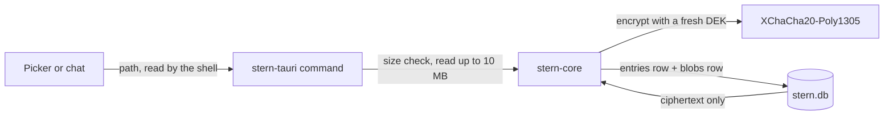

# File Upload

- **Date Created:** 2026-11-24
- **Issue:** [#22](https://github.com/christopheryang/stern/issues/22) (deleted; recreated under a new number when filed again)
- **Branch:** `feat/22-file-upload`

## Requirements

### Goal

Let a user keep a file in the vault, not only pasted text. Stern is for
notes and documents, and today a "document" is text typed or pasted into
chat. A user should be able to add a real file (a PDF, an image, a
spreadsheet, or a plain text file) and get it back later, with the same
privacy as any other entry.

### User Story

As a user who keeps important documents, I want to add a file to Stern
so that it is encrypted on my computer alongside my notes, and I want to
get it back out when I need it.

### Functional Requirements

- A user can add a file from a file picker, and from chat with "save a
  file".
- A file larger than **10 MB** is rejected before any of it is read into
  memory, with the message "That file is too big. The limit is 10 MB."
- A file of 10 MB or less is stored encrypted in the vault.
- Text files (valid UTF-8) are stored as text; everything else is stored
  as binary, with its original file name and type.
- A user can list, retrieve (save to a location they choose) and delete a
  stored file.
- Stored files are removed with the vault's other entries when the vault
  is reset, and included in an export only as ciphertext.

### Non-Functional Requirements

- **Privacy.** File contents are encrypted with the same scheme as other
  entries. Nothing is sent over a network. Plaintext is held in zeroizing
  buffers while in memory.
- **Bounded memory.** The size limit is enforced on the file's size
  before reading, and the read is capped, so the limit holds even if the
  file changes during the read.
- **Responsiveness.** Adding or reading a 10 MB file should take about a
  second on a typical laptop, and must not freeze the window.
- **Portability.** Works the same on macOS, Windows and Linux; the vault
  stays a single SQLite file (ADR-0004).
- **No new network access or runtime dependency.**

## Acceptance Criteria

- [ ] A file of exactly 10 MB is stored; a file of 10 MB + 1 byte is
      rejected, and nothing is written to the vault.
- [ ] The size check happens before the file is read: a test shows the
      rejection with a file that cannot be read.
- [ ] A UTF-8 text file round-trips as text; a PNG round-trips
      byte-for-byte.
- [ ] A file whose name ends in `.txt` but whose bytes are not valid UTF-8
      is stored as binary.
- [ ] A stored file can be listed, retrieved to a chosen location, and
      deleted; delete removes the file's blob row.
- [ ] Tampering with a stored blob (one byte changed) makes retrieval fail
      with a decryption error, and nothing is returned.
- [ ] The file's plaintext never appears in the chat transcript or in
      logs.
- [ ] The help page and the user guide describe the limit and how to get a
      file back out.

## Planning

### Problem

Entries can hold only short text fields. A user cannot keep a PDF, a photo
or a spreadsheet in Stern, so the app cannot be the one place they keep
their documents.

### Solution

Store each file as one encrypted **blob** in the vault's SQLite database,
in a separate table keyed by the entry it belongs to. The file's own
metadata (name, type, size) lives in the existing entry, so the list view
does not need to read any file contents.

### Scope

- A `blobs` table and the repository methods to add, read and delete a
  blob.
- A file picker in the UI and a "save a file" chat intent that opens it.
- Text-or-binary detection and the 10 MB limit.
- Retrieval to a location the user chooses (native save dialog).
- Help, user guide and tests.

### Out of Scope

- Files over 10 MB, and folders.
- Editing a file in place, or previewing binary formats.
- Sync or sharing.
- Migrating existing text documents into blobs.
- Export of file contents in plaintext.

### Architecture



The file is read by the Rust shell, never by the web frontend. The
frontend sends a path chosen through the native dialog and receives
metadata back; it never holds the bytes.

## Architectural Decisions

### 1. Store files as encrypted blobs in SQLite

**Decision:** a new `blobs` table in the same `stern.db`, one row per
file, with the ciphertext in a `BLOB` column.

**Why:** ADR-0004 makes one SQLite file the whole vault, so backup, move
and delete stay single-file operations. SQLite is transactional, so a file is either fully stored
or not stored at all. The existing `blob_aad` helper and `BLOB_AAD_SUFFIX` constant were already
defined for this purpose.

**Rejected for this release:** files on disk beside `stern.db`. That splits
the vault across two places, makes backup and delete error-prone, and
leaves plaintext-looking file names in the app folder.

### 2. Each blob has its own data key and its own AAD

Each blob is encrypted with a fresh DEK, wrapped under the KEK exactly as
entries are. The AAD is `blob_aad(entry_id)`, so a blob cannot be moved to
another entry without detection. Its nonce is random (XChaCha20 has a
24-byte nonce, safe for random generation).

### 3. The size check happens before the read

The shell calls `metadata()` on the opened file and rejects anything over
10 MB. It then reads with `take(limit + 1)`, so a file that grows during
the read still cannot exceed the limit. This is the same pattern the
import path uses.

### 4. Text vs. binary is decided by content, not extension

The file is text if its bytes are valid UTF-8 and contain no NUL byte.
The extension only supplies the stored type label. This matches the
requirement that the extension is not trusted.

### 5. Frontend never holds file bytes

The file is read in the shell and encrypted there, so plaintext does not
cross the IPC boundary in either direction except on an explicit retrieve,
which writes straight to the user-chosen path.

## Implementation Details

### Schema (migration)

```sql
CREATE TABLE IF NOT EXISTS blobs (
    entry_id     TEXT PRIMARY KEY REFERENCES entries(id) ON DELETE CASCADE,
    dek_wrapped  BLOB NOT NULL,     -- 40 bytes, DEK wrapped under the KEK
    nonce        BLOB NOT NULL,     -- 24 bytes
    ciphertext   BLOB NOT NULL,     -- file bytes + 16-byte Poly1305 tag
    byte_len     INTEGER NOT NULL,  -- plaintext length, for display only
    mime_type    TEXT NOT NULL,     -- non-secret label, e.g. "application/pdf"
    is_text      INTEGER NOT NULL   -- 1 if valid UTF-8, else 0
);
```

Metadata that the list view needs (the file name) stays in `entries.name`,
which is already a plaintext column, as for every other entry. The blob's
`byte_len`, `mime_type` and `is_text` are non-secret, but they do reveal the
file's size and kind; that is accepted and documented in the Security
design doc.

The migration only adds a table, so existing vaults open unchanged.

### Write path

1. The shell opens the chosen path and checks the size (Decision 3).
2. It reads the bytes and detects text or binary (Decision 4).
3. It generates a DEK, encrypts the bytes with `blob_aad(entry_id)`, and
   wraps the DEK under the KEK.
4. In one SQLite transaction it inserts the `entries` row and the
   `blobs` row. If either fails, neither is kept.
5. Plaintext buffers are zeroized before the command returns.

### Read path

1. Load the blob row, unwrap the DEK with the KEK, decrypt with
   `blob_aad(entry_id)`. A failure is a decryption error, and nothing is
   returned.
2. Write the bytes to the path the user chose in the native save dialog.
   The file is created with owner-only permissions on Unix, as exports are.

### Commands

Implemented in `desktop/stern-tauri/src/files.rs`:

- `add_file_from_picker` opens the native file picker, then stores the
  chosen file. It returns the new entry id, or nothing if the user cancels.
- `save_file_to_picker(entry_id, suggested_name)` decrypts a stored file
  and writes it where the user chooses, through the native save dialog. It
  never replaces an existing file.
- `delete_stored_file(entry_id)` removes the entry and its blob.

**Chat and the picker.** "Save a document" opens a file picker card in the
chat (`open_file_picker`), and the picked file is stored by
`add_file_from_picker`. Chat never receives file bytes. Listing, deleting
and renaming a stored file work like any other entry. Retrieving a file
to disk through the picker is available as a command; a chat control for
it is still to do.

## Test Cases

| Case | Expected |
| --- | --- |
| File of exactly 10 MB | Stored |
| File of 10 MB + 1 byte | Rejected before reading; no rows written |
| UTF-8 `.txt` | Stored with `is_text = 1` and round-trips as text |
| PNG bytes | Stored with `is_text = 0` and round-trips byte-for-byte |
| `.txt` name, invalid UTF-8 | Stored as binary |
| Empty file | Stored and round-trips as zero bytes |
| One byte changed in `ciphertext` | Retrieval fails with a decryption error |
| Blob row copied to another entry | Retrieval fails (AAD mismatch) |
| Delete entry | Blob row removed by cascade |
| Export with a stored file | Blob is ciphertext only; no plaintext in the export |
| Vault locked | Add and get are refused with "vault locked" |

## Caveats / Follow-Ups

- **Retrieving a file from chat.** Adding a file is wired to the chat and
  a picker card. Saving a stored file back to disk is a command only; a
  chat control for it is not built yet.

- **Size reveals information.** A blob's ciphertext length reveals the
  file's approximate size. Padding to fixed sizes would hide it at a cost
  in storage; not done in this release.
- **Limit may need revisiting.** 10 MB is a starting point. Raising it
  means re-measuring read and decrypt time; the constant is in one place.
- **Export.** Exports include blobs as ciphertext. Import of blobs is part
  of the import/export work tracked in #23.
- **Backup of large vaults.** A vault with many files grows the single
  `stern.db`; backups copy the whole file.
- **Legal review.** The disclaimer has not had legal review; storing
  documents may need its wording to change.
