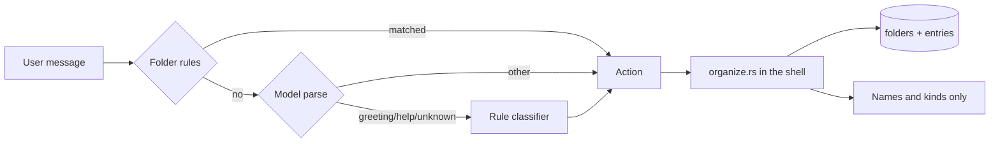

# AI Conversation

- **Date Created:** 2026-11-25
- **Branch:** `feat/ai-conversation`
- **Decision record:** [ADR-0016](../adr/0016-Nested-Folders-Without-Showing-Secrets.md)

## Requirements

### Goal

Make chatting with Stern feel natural: understand more ways of asking,
answer small talk directly, and help manage the vault by listing,
renaming, deleting and organising entries into folders, without ever
putting a secret on screen.

### User Story

As someone who keeps notes, documents and passwords in Stern, I want to
talk to it in my own words and see how my vault is organised, so I can
find and tidy things without remembering exact commands.

### Functional Requirements

- "Save a document" opens a file picker. Nothing is saved until a file is
  picked, and an empty document is never created.
- Chat understands everyday phrasings for finding, saving, deleting,
  listing, exporting and importing (for example "I forgot my router
  password", "jot down a note", "get rid of my Netflix login", "what do I
  have saved", "back up my vault").
- Small talk (thanks, goodbye, "who are you", a bare "ok") gets a short,
  friendly answer and never asks for the master password.
- "What can you do" shows what Stern can do, including find, list and
  folders.
- Folders: create (at the top or inside another), move an entry into one
  or take it out, move a folder, rename, delete, and show the tree or one
  folder.
- List: "show my secrets" shows names, kinds and folders; "show my notes"
  or "show my passwords" filters by kind.
- Rename an entry or a folder. Delete an entry only after a yes.

### Non-Functional Requirements

- **No secret in a listing.** Trees and lists use names and kinds only.
- **No model prose.** Replies come from fixed text and deterministic code,
  never from the model.
- **Safe by default.** Anything unclear cancels rather than deletes.
- **Folder names are encrypted** and bound to their folder.

## Acceptance Criteria

1. Choosing "Save a document" shows the file picker and saves nothing
   until a file is picked.
2. "create folder Kids in Streaming" makes a nested folder; "move Netflix
   to Streaming > Kids" files the entry there.
3. "show my folders" draws the tree and contains no stored value.
4. Moving a folder into itself or its own child is refused.
5. Deleting a folder keeps its entries and sub-folders, one level up.
6. "delete Netflix" asks for confirmation; "No" and any other message keep
   the entry; only "Yes" deletes it.
7. "rename Netflix to Netflix Family" keeps the entry's secrets readable
   under the new name.
8. "thanks", "bye" and "who are you" get friendly answers and no password
   prompt.
9. An older vault opens, gains folders, and keeps every entry.

## Planning

### Problem

Chat could save and find things, but "save a document" saved an empty
document, many natural phrasings were not understood, and there was no
way to list, rename, delete or organise anything.

### Solution



- Folder wording is read by exact rules first, because it is precise
  ("move X to Y") and a small model does not know it.
- The model's answer is double-checked by the rules when it is a greeting,
  help or "unknown", so a weak parse cannot swallow a request the rules
  understand.
- Everyday phrasings are rewritten to a plain verb before the rules run
  (`normalize_phrases`). Only the start of the message is rewritten, so
  stored values are never touched.
- The shell's `organize` module carries out folder, list, rename and
  delete actions. It decrypts only folder names.

### Scope

- Folder, list, rename, confirmed delete, document picker, wider wording,
  small-talk replies, new starter chips.

### Out of Scope

- Folders in export and import.
- Moving several entries at once.
- Searching inside notes.
- A drag-and-drop folder view.

## Architectural Decisions

See [ADR-0016](../adr/0016-Nested-Folders-Without-Showing-Secrets.md).

## Implementation Details

| Area | Where |
| --- | --- |
| Folder rules (depth, loops, paths, tree drawing) | `core/stern-core/src/domain/vault/folder.rs` |
| Storage and migration | `infrastructure/sqlite/repository.rs` (`folders` table, `entries.folder_id`) |
| Folder AAD | `domain/vault/aad.rs` (`folder_aad`) |
| Wording | `ai/intent.rs` (`classify_folder_intent`, `normalize_phrases`, `detect_chatter`) |
| Chat actions and replies | `ai/chat.rs` |
| Carrying actions out | `desktop/stern-tauri/src/organize.rs` |
| Starter chips | `desktop/stern-ui/src/components/chat.rs` |

Schema additions:

```sql
CREATE TABLE folders (
  id TEXT PRIMARY KEY,
  parent_id TEXT REFERENCES folders(id) ON DELETE SET NULL,
  dek_wrapped BLOB NOT NULL, nonce BLOB NOT NULL, ciphertext BLOB NOT NULL,
  created_at TEXT NOT NULL, updated_at TEXT NOT NULL
);
ALTER TABLE entries ADD COLUMN folder_id TEXT REFERENCES folders(id) ON DELETE SET NULL;
```

A folder reference in a request is a name ("Taxes") or a path
("Taxes > 2024" or "Taxes/2024"). When several folders share a name, Stern
lists their full paths and asks for one.

## Test Cases

| Case | Expected |
| --- | --- |
| Depth, loop and placement rules | Self and descendant placement refused; depth capped at 8 |
| Move that would loop, at the database | Refused, nothing written |
| Delete a middle folder | Children and entries move up one level |
| Old vault opened twice | Column added once; entries kept |
| Tree with values stored | No stored value in the text |
| Folder name swapped onto another folder | Decryption fails |
| Delete asks; "No", or any other message | Nothing deleted |
| Rename an entry | Secrets still readable under the new name |
| "thanks", "bye", "who are you" | Friendly reply, no password prompt |
| Everyday phrasings | Classified as find, save, delete or list |
| Stored value case | Unchanged by phrase rewriting |

## Caveats / Follow-Ups

- Export and import do not carry folders yet.
- Folder structure (how many, how deep, how many entries each) is visible
  to anyone holding the database file, though not the names.
- The model is not taught folder wording; rules handle it. If a larger
  model is used later, add worked examples to its prompt.
- The User Guide screenshots predate several changes and need regenerating
  with `tools/screenshots/capture.sh`.
