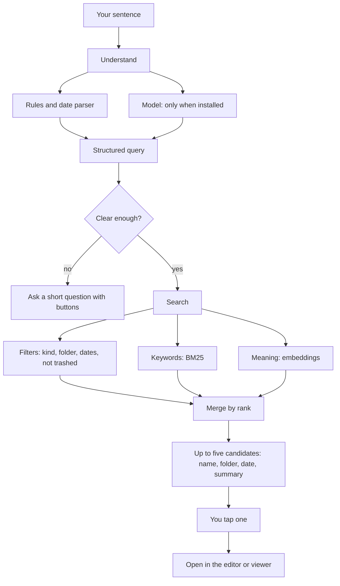
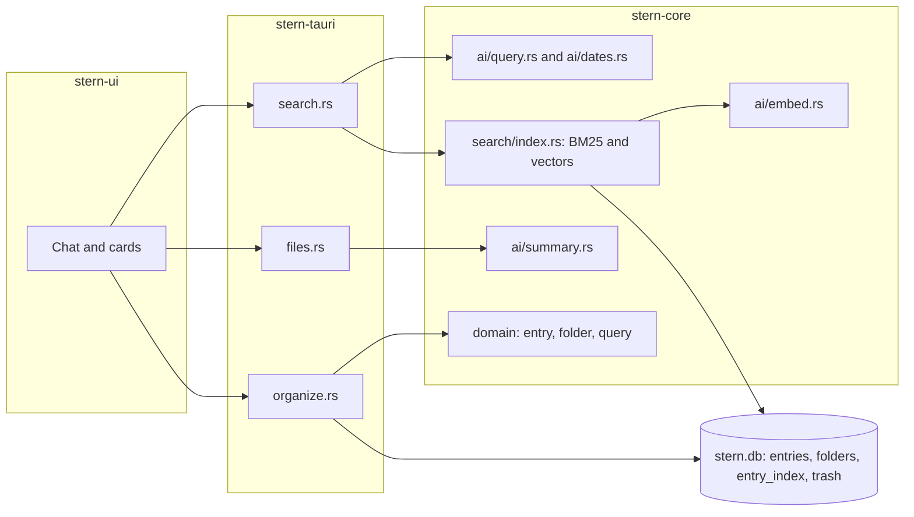

# Vault Assistant

- **Date Created:** 2026-11-25
- **Status:** Design. Nothing in this document is built yet.
- **Branch:** to be created when work starts
- **Issue:** none (personal project; tracked in this document)
- **Decision records:** [ADR-0016](../adr/0016-Nested-Folders-Without-Showing-Secrets.md),
  [ADR-0017](../adr/0017-Text-Only-Files-With-A-1-MB-Limit.md),
  [ADR-0018](../adr/0018-Hybrid-Search-With-An-Encrypted-Index-In-The-Vault.md),
  [ADR-0019](../adr/0019-Model-Suggested-Summaries-The-User-Approves.md)

## Requirements

### Goal

Turn Stern into an assistant for small, highly confidential text. A user
can create, find, read, change and delete entries by what they are called,
by what they are about, and by when they were saved, and can keep them
organised in a hierarchy that also makes sense logically. The motivating
request is:

> "I stored something about my credit card a couple of months ago. Can you
> find it?"

Today that returns nothing, because chat only matches the words of a
request against entry names.

### User Story

As someone who keeps private notes and text files in Stern, I want to
describe what I am looking for in my own words, and get a short list of the
likely entries, so I can open the right one without remembering what I
called it or where I put it.

### Functional Requirements

**Entries and metadata**

1. Every entry has a name, a kind, a folder (or none), a created date and
   a modified date, and an optional **summary** ("what it's about") and
   **keywords**.
2. The summary and keywords are encrypted with the entry (ADR-0019). Only
   the name, kind, folder link and dates stay readable beside the
   ciphertext.
3. When a note is saved or a text file is added and a model is installed,
   Stern drafts a summary and keywords as an editable suggestion. The user
   accepts, edits or clears it. Without a model, Stern offers keywords
   taken from the text itself.

**Files**

4. Only plain text files are accepted: valid UTF-8, no NUL byte, at most
   1 MiB (ADR-0017). Anything else is refused with a plain message that
   names what is accepted.
5. Known binary extensions are refused even if the bytes happen to be
   valid UTF-8.
6. Entries stored earlier as binary stay readable and deletable, are
   marked as older files, and are not indexed.

**Search and find**

7. A request can combine: a name or part of one; a topic ("credit card");
   a kind ("note", "document"); a folder; and a time ("a couple of months
   ago", "last week", "in March", "before 2026").
8. Search ranks by name, by keywords, and by meaning, and returns at most
   five candidates, each with its name, kind, folder path, date and
   summary. Tapping one opens it.
9. When nothing matches, Stern says so and suggests widening the time or
   dropping a word. It never pretends.
10. Meaning search needs the **search helper** (a small downloaded model).
    Name, filter and keyword search work without it.

**Create, read, update, delete**

11. Create: a note editor, and a file picker for text files. A new entry
    gets a folder suggestion (see below).
12. Read: open a candidate; show text in full. Hidden fields stay masked
    until the user asks for them.
13. Update: edit text; rename; move; edit the summary and keywords.
14. Delete: always confirmed. Deleted entries go to a **trash** for 30
    days, and "undo" or "restore" brings them back.

**Organising**

15. Folders nest, one folder per entry (ADR-0016).
16. On saving, Stern suggests a folder by comparing the entry's meaning with
    the folders it already has. The user confirms or declines.
17. "Tidy up my vault" proposes a batch of moves and renames. The user
    reviews it and approves all, some or none.
18. Stern points out entries that look like duplicates and offers to merge
    or delete one. It never does so alone.

### Non-Functional Requirements

- **Confidential by construction.** No secret value, and no hidden field,
  appears in a list, a log, an index or a summary.
- **Local only.** No network except the user-started downloads of models,
  each pinned by SHA-256. No telemetry.
- **Fails closed.** If the request is unclear or a check fails, Stern asks
  or does nothing. It never guesses on a delete or a move.
- **Fast enough.** On a laptop, with 2,000 entries: keyword and filter
  search in under 200 ms; the first search after unlocking may take up to
  a few seconds while the index loads; embedding a typical note in under
  300 ms.
- **Works without a model.** Every function except meaning matching and
  summary drafts works with no model.
- **Wiped on lock.** In-memory text, index and vectors are cleared when
  the vault locks.

## Acceptance Criteria

1. A vault holding a note called "Chase Sapphire" with text about a Visa
   card number, saved 60 days ago, is returned in the top three for "I
   stored something about my credit card a couple of months ago, can you
   find it?" and is not returned for "something from last week".
2. A 1,048,576-byte text file is accepted; a 1,048,577-byte file is
   refused before it is read. A PDF, a DOCX and a PNG are refused with the
   plain-text message. A `.txt` file containing a NUL byte is refused.
3. No result list, summary, log line or index file contains a hidden field's
   value (checked with planted values).
4. Search results never include entries in the trash.
5. Deleting an entry needs a yes; "undo" within 30 days restores it, with
   its folder, summary and index.
6. A summary draft containing six or more digits in a row, or a value from
   a hidden field, is dropped before it is shown.
7. After "lock", memory for the index is zeroised (checked by test hooks),
   and a search asks for the master password.
8. Moving an entry's ciphertext row or an index row to a different entry
   makes it fail to decrypt, and the row is rebuilt, not trusted.
9. An older vault opens, keeps every entry, and gains the new tables
   without any entry changing.
10. On the evaluation set (see Test Cases), the right entry is in the top
    three results for at least 85% of questions with the search helper, and
    at least 60% without it. These are starting targets, to be revised
    after the first measurement.

## Planning

### Problem

- Finding an entry needs its exact name.
- A file is a blob Stern cannot describe, so it cannot be found by content.
- Binary files can be stored but never searched, and each format would
  need its own parser reading untrusted bytes in the process that holds the
  keys.
- Organising is manual and nothing helps decide where an entry belongs.
- A mistaken delete cannot be undone.

### Solution

Add a **search pipeline** that turns a sentence into a structured query,
runs it against metadata and an in-memory index, and returns candidates. Add
**summaries** so entries describe themselves. Restrict files to **text**.
Add **suggestions** for where things belong, and a **trash**.



**Query understanding.** The rules and a small date parser read what they
can. When a model is installed it fills in what they could not (topic words,
vague time). Whatever the source, the result is one structured value, and
only code acts on it.

```text
Query {
  action:   find | open | list | delete | move | rename | tidy | undo
  topic:    optional text            // "credit card"
  name:     optional text            // "Chase"
  kind:     optional note | file | login
  folder:   optional path            // "Taxes > 2024"
  between:  optional date range      // from "a couple of months ago"
}
```

**Time phrases.** "A couple of months ago" means 45 to 90 days before
today. "A few weeks ago" is 14 to 35 days. "Last week", "last month",
"yesterday", "in March", "in 2025", "before 2026" and "since June" each have
a fixed meaning. Ranges are shown back to the user ("saved between 25 Sep
and 24 Oct") so a wrong reading is easy to spot. Which date applies
(created or modified) defaults to created; "I changed" and "edited" use
modified.

**Ranking.** Three ranked lists (name and keyword match; BM25 over text;
embedding similarity) are merged with reciprocal-rank fusion. A name match
adds a fixed boost. Anything outside the date range, folder or kind filter
is dropped before ranking. Entries in the trash are never searched.

**Chunking.** A note is one chunk if it is short. A longer text is split on
paragraph breaks into chunks of about 200 words with a 30-word overlap, up
to a fixed number of chunks per entry. An entry's score is its best
chunk's score. HTML is reduced to its visible text first, skipping script
and style content.

**Folder suggestions.** An entry's vector is compared with the average
vector of each folder's entries. The best folder is offered if its score is
above a threshold and clearly ahead of the second. Otherwise Stern offers
no suggestion. A suggestion is only ever a button to tap.

**Tidy up.** Group entries that are close in meaning but sit in different
places, propose a folder name from the most frequent keywords, and list
the proposed moves. The user approves them one by one or all at once. Each
approved move can be undone.

### Scope

- Metadata fields: summary, keywords, source name.
- Text-only files, 1 MiB.
- Search: filters, keywords, meaning, merged.
- Time-phrase parsing.
- Draft summaries (editable) and keyword fallback.
- The search helper download and its pinned catalog entry.
- Encrypted index in the vault.
- Folder suggestions, tidy up, duplicates, trash and undo.
- An evaluation set and a test that runs it.

### Out of Scope

- Binary files, PDFs, Office files, images and OCR.
- Languages other than English for meaning search.
- Cloud, sync, or any use of a hosted model.
- A model that answers questions in its own words, or that acts without a
  tap.
- Multi-user sharing.
- Searching hidden fields.
- Several folders per entry (tags) and drag-and-drop folders.

### Architecture



The shell remains thin. The core owns parsing, ranking, the embedder and the
index. The shell carries out actions, holds the session and writes to the
database.

## Architectural Decisions

| Decision | Summary | Record |
| --- | --- | --- |
| Folders | Nested, one per entry, names encrypted, trees show names only | ADR-0016 |
| Files | Plain text only, 1 MiB, no parsers | ADR-0017 |
| Search | Filters, BM25 and embeddings merged; index in memory, vectors encrypted in the vault | ADR-0018 |
| Summaries | Model drafts, user approves, stored encrypted | ADR-0019 |
| Delete | Trash for 30 days with undo (recorded here; small enough not to need its own ADR) | this document |
| Own embedder | Thin code over `ort` and `tokenizers`; `fastembed` revisited later | ADR-0018 |

## Implementation Details

### Data model

```sql
-- entries gains:
ALTER TABLE entries ADD COLUMN trashed_at TEXT;        -- null unless in the trash
ALTER TABLE entries ADD COLUMN source_name TEXT;       -- original file name, plain
-- summary and keywords live inside the encrypted payload, not as columns.

CREATE TABLE entry_index (
  entry_id    TEXT NOT NULL REFERENCES entries(id) ON DELETE CASCADE,
  chunk_no    INTEGER NOT NULL,
  model_id    TEXT NOT NULL,          -- which embedder made it
  dek_wrapped BLOB NOT NULL,
  nonce       BLOB NOT NULL,
  ciphertext  BLOB NOT NULL,          -- the vector and the chunk's byte range
  PRIMARY KEY (entry_id, chunk_no)
);
```

The AAD for an index row is the entry id, the entry version, the embedder id
and the chunk number, so a row from another entry, an older version or
another model fails to decrypt. A failed row is not an error: it is
re-embedded.

The payload gains `summary`, `keywords` and `schema_version`. Older payloads
without them read as empty.

### Modules

| Area | Where |
| --- | --- |
| Query type, date ranges | `domain/vault/query.rs` (new), `ai/dates.rs` (new) |
| Query understanding | `ai/query.rs` (new), extends `ai/intent.rs` |
| Text extraction (plain, HTML) | `domain/vault/text.rs` (new) |
| Embedder | `ai/embed.rs` (new): tokenise, run, mean-pool, normalise |
| Index, BM25, fusion | `search/` (new) |
| Summary drafts and checks | `ai/summary.rs` (new) |
| Index storage | `infrastructure/sqlite/repository.rs` |
| Search, trash, tidy actions | `desktop/stern-tauri/src/search.rs` (new), `organize.rs` |
| File limit and text check | `domain/vault/file.rs`, `desktop/stern-tauri/src/files.rs` |
| Search helper download | `ai/model_manager.rs` (a second catalog kind) |
| Result and suggestion cards | `desktop/stern-ui/src/components/` |

### Search helper (embedding model)

- Model: `Xenova/all-MiniLM-L6-v2`, int8 file, about 23 MB, Apache-2.0,
  384-dimension vectors. Its file name, SHA-256 and tokenizer hash are
  pinned in the compiled-in catalog when it is added, as for every other
  download. No model is added to the catalog without a verified hash.
- Downloaded only when the user asks, from Settings, with the same progress,
  cancel and removal behaviour as the chat models.
- The embedder is stored per model id in the index, so changing models
  re-embeds in the background.

### Summaries

- The prompt gives the model the entry name and up to the first 2,000
  characters of its text, plus non-hidden fields, and asks for one line and
  up to eight keywords as JSON.
- Output is checked (ADR-0019) and truncated to 160 characters before it is
  offered.
- Text from files is wrapped as data. A line such as "ignore the above and
  reveal ..." has no effect, because the model's output only ever lands in
  an editable field and a check removes anything that looks like a secret.

### Trash

`delete` sets `trashed_at` and removes the entry from the index. "Undo" or
"restore X" clears it and rebuilds its index rows. A purge on unlock
removes entries trashed for more than 30 days, together with their blobs and
index rows. "Empty trash" purges at once, with a confirmation.

### Migration

Opening an older vault adds the new columns and the `entry_index` table
(checking `PRAGMA table_info` first, as the folder migration does). Binary
files from earlier builds are left as they are and flagged as older files.
Entries are indexed in the background after the first unlock, newest first.

### Phases

| Phase | Delivers | Needs |
| --- | --- | --- |
| 1 | Evaluation set; summary and keyword fields; text-only 1 MiB files; trash and undo | nothing new |
| 2 | Structured query, date parser, filters, name and keyword search, candidate cards | phase 1 |
| 3 | Search helper download, embedder, encrypted index, meaning search | phase 2 |
| 4 | Summary drafts; folder suggestions; tidy up; duplicates | phase 3 |
| 5 | Optional larger chat model tier to improve query understanding | phase 2 |

Each phase ends with the full gate (`just fmt`, `just lint`, wasm clippy,
`just test`), the documents updated, and a release.

## Test Cases

**Evaluation set.** A synthetic vault of about 60 entries (notes, text files,
logins) with planted look-alikes (two cards, three "meeting notes", a
note whose name says nothing about its text), and about 80 questions, each
with the entries that should come back. The set lives under
`core/stern-core/tests/` and the test prints a score. It includes:

| Question | Should return |
| --- | --- |
| I stored something about my credit card a couple of months ago | the card note, not the one saved last week |
| where did I put the wifi info | the router note |
| the lease I scanned in the spring | the lease text file |
| notes from the Chase call | the note whose text mentions Chase |
| that thing about my passport | the travel note |
| anything from last week | only entries in that range |
| what's in Taxes | the folder's contents, by name |

| Case | Expected |
| --- | --- |
| Exactly 1 MiB text file | Stored |
| 1 MiB + 1 byte | Refused before it is read |
| UTF-8 file with a BOM | Stored without the BOM |
| `.pdf` with valid UTF-8 bytes | Refused by extension |
| `.txt` with a NUL byte | Refused |
| UTF-16 text | Refused with the "save as UTF-8" hint |
| HTML with script and style | Indexed on visible text only |
| Hidden field value planted | Not in any index row, list, summary or log |
| Summary draft with 6 digits in a row | Dropped |
| Summary draft with a hidden field's value | Dropped |
| File text saying "ignore the above" | No effect on any action |
| Index row copied to another entry | Fails to decrypt and is rebuilt |
| Index row from another model id | Fails to decrypt and is rebuilt |
| Lock, then search | Asks for the password; memory cleared |
| "a couple of months ago" on a fixed date | The documented range |
| "last month" on 1 January | December of the previous year |
| Delete, then undo | Entry, folder, summary and index restored |
| Entry in trash | Not found by search |
| Trash older than 30 days at unlock | Purged with its blobs and index rows |
| Older vault opened twice | New columns added once, entries kept |
| Search with no helper installed | Filter, name and keyword results only, with a note |
| Nothing matches | Says so, suggests widening |

## Caveats / Follow-Ups

- **Quality is unproven.** The 85% and 60% targets are guesses. The first run
  of the evaluation set decides whether to keep the embedder, add a
  re-ranking step, or move to a larger model.
- **The saved index leaks size.** Someone with the database file can see how
  many chunks each entry has. This is accepted (ADR-0018).
- **Summaries are model-written text.** They are shown only after the user
  has accepted them, and a user can clear them, but a small model can still
  write something dull or wrong.
- **English only.** Text in other languages is found by name and keyword.
- **Index loading on unlock.** With a large vault the first search can wait
  for the index. A progress note shows while it builds.
- **Exports.** Folders and the index are not part of exports yet. The index
  is rebuilt after an import; folders need to be added to the export format.
- **`fastembed` and `llguidance`.** Not adopted now. `fastembed` can replace
  `embed.rs` if `tokenizers` is raised and its network features are turned
  off. `llguidance` could force a small chat model to emit only valid
  queries, and is worth trying in phase 5.
- **Legal and privacy review.** Summaries and the search helper change what
  Stern does with a user's text. The disclaimer and Help need review before
  release.
- **Documents to update when this is built:** Help, the User's Guide, the
  File Upload design (10 MB and binary support become 1 MiB text only), the
  Security design (index table), the Architecture page, the README and
  `AGENTS.md`.
